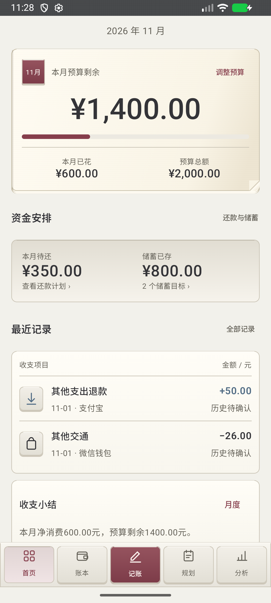
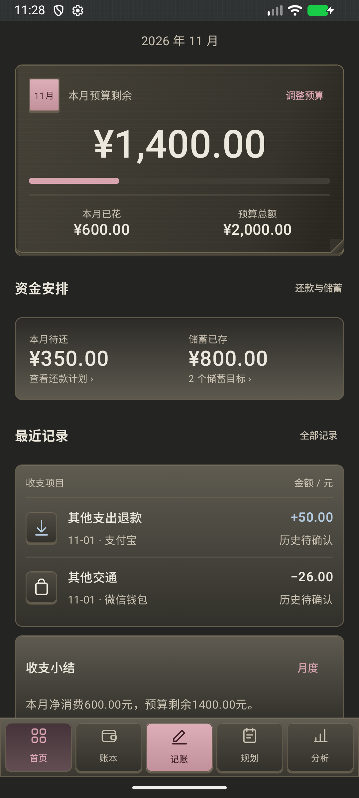
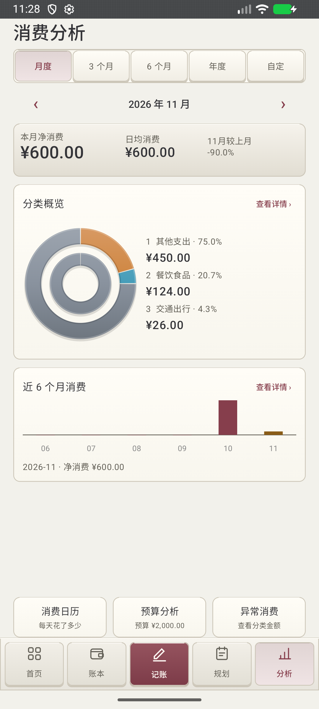
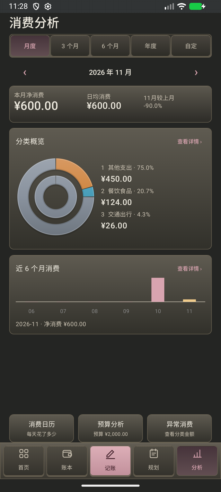

# 等风 · Dengfeng

面向大学生的 Android 本地记账与消费规划 App。当前为 **0.15.1-preview**：暖白纸页、石墨状态栏、酒红操作键与简约拟物图表，支持深色模式。

**由梨花怎黛玉与 OpenAI Codex 共同设计。** 梨花怎黛玉提出产品需求、选择并打磨交互与视觉；OpenAI Codex 提供 AI 辅助设计、代码实现与测试支持。署名不代表 OpenAI 官方发布或背书。

## 下载安装

[下载 0.15.1 APK](https://github.com/Narcissus521/dengfeng/releases/download/v0.15.1/Dengfeng-0.15.1-preview.apk) · [版本说明与公开源码包](https://github.com/Narcissus521/dengfeng/releases/tag/v0.15.1) · [全部版本](https://github.com/Narcissus521/dengfeng/releases)

- Android 8.0 / API26 及以上；使用本项目提供的同签名 APK 可覆盖升级，请勿先卸载。
- 首次打开需同意使用声明；同意后不再自动出现，设置可主动查看。已有账本保持，新安装只创建空个人账本。
- 体验包沿用开发签名。仓库不含私钥；自行构建的签名可能不同，无法保证覆盖已有安装。

## 本次与近期更新

- 去掉四个主页面的应用名称和独立高顶栏，只保留系统状态栏安全高度。
- 房贷／其他负债详情直接设置“还款计入月度预算与消费分析”，只影响之后的还款。切换不改现金、欠款进度或历史流水；历史重算需在编辑计划中明确勾选。
- 负债具有独立的欠款种类、固定两级消费用途和必要／非必要属性。建计划不记消费，实际还款按开关计入当月消费和预算，现金只扣一次；例如 6000 元手机分12期，每次500元可计入数码消费。
- 固定收入／消费改为打开 App 后确认，可改本次金额、日期和账户组合，确认才记账；跳过的期次不再生成，修改本次不改计划。
- 编辑理由可留空，内部仍保留修改历史；记账记录不显示内部编号。
- 双环图保留固定分类颜色、右侧图例和明细下钻，增加克制的厚度与细边高光；完整页面横向推进／返回，快捷调整仍为同页窗口。
- 每日提醒在设定时间段内最多一次，即使当天已记账仍可提醒，错过时段不补发；送达受系统后台限制和通知权限影响。
- 设置从底部记账窗口进入，保留主题、动效、账户和署名声明；移除演示切换、导入导出、全局历史和新手教程界面。

## 界面

| 浅色 | 深色 |
|---|---|
|  |  |
|  |  |

截图仅使用隔离测试账本，非个人财务数据。

## 主要能力与口径

多账户余额、收入支出、转账、关联退款、余额校准、历史编辑与逻辑撤销；月度总预算、必要／非必要和分类预算；1–360期同额或逐期负债及组合还款；储蓄目标、已存、差额及每月建议；消费日历、分类／必要性、6／12月趋势、预算及可解释异常分析；一次付款与分期购买模拟。

分类按用途而非购买渠道。12个一级类别含二级选项，公益捐赠与其他支出直接记到一级；学习教育含 AI 费用，居住通讯含房租／房贷。新支出默认必要消费，历史未判断仍独立统计，不自动猜测。转账和余额校准不算消费；退款按实际到账日期冲减原消费；开启消费开关的还款只用同一组流水统计一次。

手动记支出时可选择花呗。购买当天计入消费，同一到期月的款项合入次月花呗账单，可在「规划 → 负债」查看。默认次月 10 日，可在花呗设置中调整默认日，也可修改单期还款日。退回花呗的退款抵减尚未结清的原账单。实际还款后选资金账户登记整期还清，账本在还款日扣减对应账户余额。

金额以整数分计算。储蓄是手动进度和规划，不冻结资金；预算、储蓄、近期还款分别展示，不简单相减成一个“可花余额”。分期金额依据用户填写的合同总额，不推算未经确认的利息公式。房贷统计开关不改变正常还款的账户扣款方式，未新增父母代还业务。

## 数据与构建

数据仅保存在本机，无联网权限、云同步或自动读取银行／支付流水，不执行真实支付。卸载或清除应用数据会删除本机账本。Room Schema8 显式迁移，不清库；旧债务默认保持旧统计，历史同步必须明确选择。内部 JSON9 兼容旧版本，App 不再提供导入导出界面。

Android Studio 打开仓库根目录，安装 SDK37 / Build Tools36.0.0，使用兼容 JDK 与 Gradle Wrapper。SDK位置由本机 local.properties 或 Android Studio 配置：

```sh
sh ./gradlew :app:assembleRelease :app:testReleaseUnitTest :app:lintRelease -PandroidTestBuildType=release
sh ./gradlew :app:assembleReleaseAndroidTest -PandroidTestBuildType=release
```

Windows 使用 gradlew.bat。仪器测试仅运行在独立测试模拟器，不对个人账本执行。仓库不包含本机配置、个人账本、设备日志、导出数据或签名私钥。

## 验证与边界

0.15.1：181项单元测试、10项相关模拟器功能场景及3项小屏／放大字体场景通过；Lint0错误。财务核心与Schema1–7相对0.15.0未改变。0.15.0完成固定确认、旧版迁移和统计新口径回归，详情见 [当前验证摘要](docs/VERIFICATION.md)。高刷新率请求不等于持续120FPS，未作新的手机帧率承诺。其他旧版专题文档应结合当前说明阅读。

## 使用声明

本 App 用于个人记账与消费规划；结果依赖用户填写的数据，仅供参考，不构成投资、借贷或专业财务建议，不保证购买或还款能力。请以真实余额、账单和合同为准，重要事项自行核对。

头像由梨花怎黛玉提供；图标说明见 [branding/README.md](branding/README.md)。许可证由作者后续确定。
