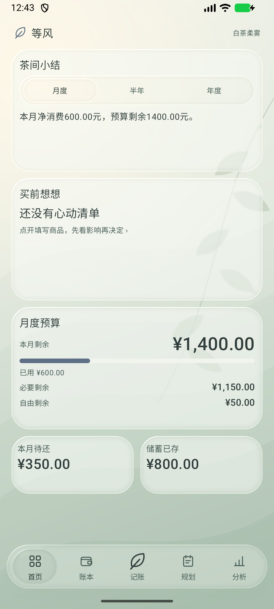
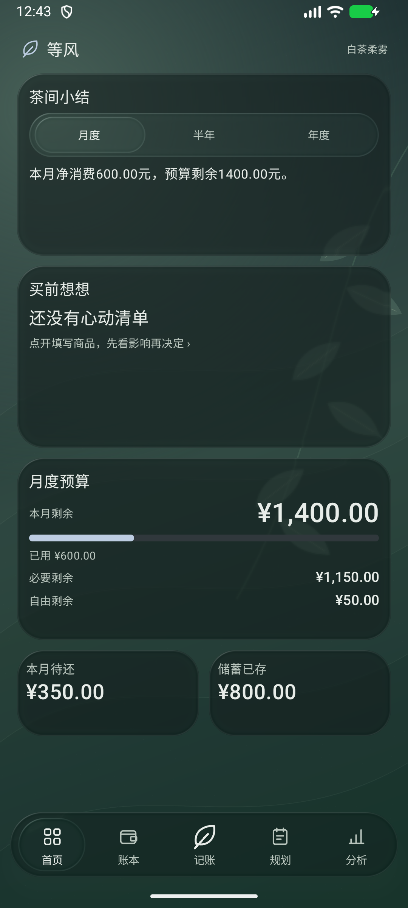

# 等风 · Dengfeng

面向大学生的 Android 个人记账与消费规划 App。白茶柔雾配色、液态玻璃卡片与可拖动的露珠 Dock。

**由梨花怎黛玉与 OpenAI Codex 共同设计。**

梨花怎黛玉负责产品构思、需求、视觉选择与交互打磨；OpenAI Codex 提供 AI 辅助设计、代码实现与测试支持。共同设计署名不代表 OpenAI 官方发布或背书。

## 下载安装

[下载等风 0.11.0 体验版 APK](https://github.com/Narcissus521/dengfeng/releases/download/v0.11.0/Dengfeng-0.11.0-preview.apk) · [全部版本](https://github.com/Narcissus521/dengfeng/releases)

- Android 8.0 / API 26 及以上；Android 13 及以上提供原生边缘折射效果，较旧系统使用简化材质。
- 安装官方提供的同签名新版可保留账本覆盖升级，请勿先卸载。
- 本仓库不包含签名私钥，自行构建的 APK 签名可能与已安装版本不同。

## 界面

| 浅色 | 深色 |
|---|---|
|  |  |

截图使用独立示例账本。

## 主要功能

- **账户与收支**：多现金账户、收入、支出、转账、退款、历史编辑与逻辑撤销、余额核对及手动校准。
- **固定收支**：每日／每月固定收入和消费，到期自动记账、可撤销，支持多账户组合扣款；独立记账提醒。
- **预算**：月度总预算、必要／自由预算分配及一级分类预算，展示已用、剩余和超支。
- **负债**：自定义欠款种类、1–360 期、每期相同或逐期填写金额、多账户组合还款。按用户填写的合同金额登记，不擅自推算复杂利息。
- **储蓄**：目标金额、日期、已存、差额与每月建议；预留是规划，不冻结真实账户资金。
- **消费分析**：固定两级分类、月／年／自定义范围、双层圆环、必要性、6／12 月趋势、预算执行及可解释的异常提示，逐层追溯交易。
- **买前想想**：分别模拟一次付款和商家分期方案对现金、预算、近期还款及储蓄安排的影响，不合成未经批准的综合可花金额。
- **外观与交互**：深浅色／跟随系统、露珠连续滑动和反向拖动、透明整页滑动、卡片展开收回、长按移动与边缘缩放、减少动态、新手教程。

公益捐赠和其他支出为直接记账的一级分类，其余 12 类保留二级分类。消费必要性独立为“必要消费／非必要消费／未判断”，未判断不自动归入其他类别；原有预算分配另行记录。

## 数据与统计

数据保存在本机，个人与示例账本分开；无需实名注册，不读取微信、支付宝或银行流水，不发起真实支付。转账、余额校准及还款本金不计消费；退款遵循原消费关联规则；分期购买与还款避免重复计算。金额使用整数分。

支持 JSON 备份导入导出（当前 v5，兼容旧版本），恢复前校验。请自行定期备份；卸载或清除数据会删除本机账本。仓库仅包含应用代码、数据库结构和示例素材，不包含个人账本、导出备份、签名私钥或本机配置。

## 构建

1. 使用 Android Studio 打开仓库根目录，安装 Android SDK 37 和 Build Tools 36.0.0；Gradle JDK 使用兼容的 Android Studio 内置 JBR。
2. 在本机 `local.properties` 中配置 SDK 路径，或由 Android Studio 自动生成。
3. 构建与检查：

```sh
./gradlew :app:assembleRelease :app:testReleaseUnitTest :app:lintRelease -PandroidTestBuildType=release
```

Windows 使用 `gradlew.bat`。默认使用本机 debug 签名构建体验包；个人签名密钥不包含在仓库中。

界面与数据库仪器测试只应在独立测试模拟器／示例账本运行，勿对个人账本运行自动测试。

## 验证与边界

0.11.0：149 项单元测试、46 项完整界面回归、2 项窄屏检查通过。Room Schema 5、JSON v5。

玻璃取景来自共享的完整静态茶色景物图层，随界面位置和缩放重采样；不声称捕获任意视频或所有前景 UI。保留高刷新率设置，请求 120 Hz 不等于持续实测 120 FPS。

## 使用说明

本 App 用于个人记账与消费规划；统计、估算和购买建议依赖用户填写的数据，仅供参考，不构成投资、借贷或专业财务建议，也不保证购买或还款能力。请以实际账户余额、账单和有效合同为准。固定收支只更新本地账本，不执行真实扣款。

头像由梨花怎黛玉提供；图标创作说明见 [branding/README.md](branding/README.md)。许可证由作者后续确定。
